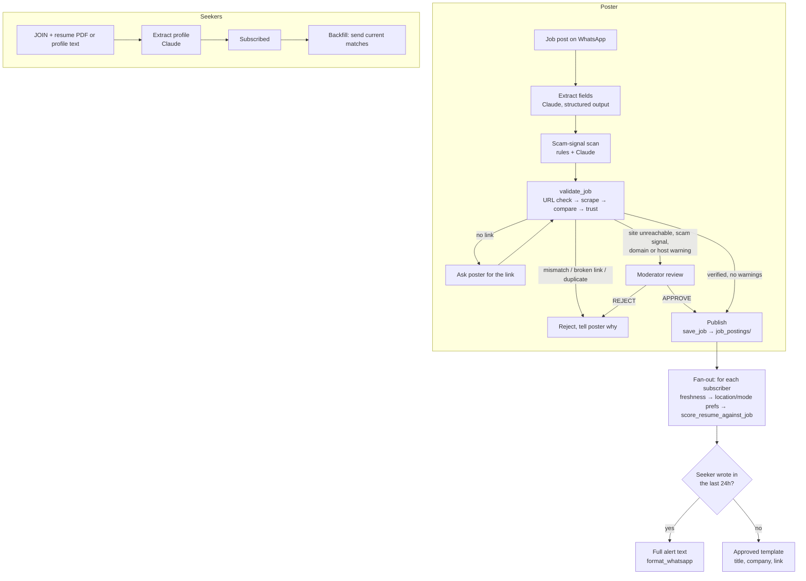

# job-hub-p2p

A WhatsApp job hub run by an agent. People who have jobs to share send them to the hub's
WhatsApp number. The agent checks each post against the employer's page and sends the
verified ones to job seekers whose profile matches.

The checks come from [job_validation_skill](https://github.com/msambenny/job_validation_skill),
copied into `.claude/skills/` and used unchanged (see [VENDORED.md](VENDORED.md)). It handles
URL checks, scraping, comparison, trust and duplicate warnings, resume scoring, the 15-day
freshness rule and WhatsApp formatting.

## Workflow



| Step | Who decides | Code |
|------|-------------|------|
| Read the post | Claude (`claude-opus-5-5`, JSON schema output); falls back to a `Label: value` parser | `hub/extract.py` |
| Verify against the employer page | job-alert-validation `run_job_validation` | `hub/workflow.py::_validate_and_route` |
| Publish / reject / review | Exit codes and `trust` warnings from the skill, plus scam signals | `JobHub._decide` |
| Human in the loop | Moderators (`HUB_ADMINS`) reply `APPROVE <id>` / `REJECT <id> <reason>` | `JobHub._approve`, `_reject` |
| Match | `posting_freshness` + `score_resume_against_job` from the skill, plus location/work-mode preferences | `JobHub.score` |
| Notify | WhatsApp Cloud API; templates outside the 24-hour window; at most `HUB_MAX_ALERTS_PER_DAY` per seeker; never twice for the same job | `JobHub._notify` |

How validation results are handled (same rules as the skill's SKILL.md):

| `validate_job` result | Hub action |
|---|---|
| exit 0, no warnings | Published and sent to matching seekers |
| exit 0, with trust warnings (Google Forms / `wa.me` / shortener host, domain mismatch, near-duplicate) or scam signals (fees, UPI, "refundable") | Held for moderator review |
| exit 0, same apply URL already on the hub | Rejected as a duplicate |
| exit 1 (critical fields don't match the page) | Rejected; poster told which fields |
| exit 2 (no URL) | Poster asked for the link, then validation resumes |
| exit 3 with an HTTP status | Rejected as a broken link |
| exit 3 without a status (proxy, timeout) | Held as *unverified* for a moderator. An unreachable site doesn't prove the job is fake |

## WhatsApp commands

| Message | Effect |
|---|---|
| `POST <job details + link>` (or just paste a job post with a link) | Validate and share a job |
| `JOIN`, then a resume PDF or text such as `Skills: …` / `Roles: …` / `Location: …` / `Mode: …` | Subscribe to alerts |
| `PROFILE <text>` | Update your profile |
| `JOBS` | Current matches |
| `MYPOSTS` | Status of your posts |
| `STOP` / `JOIN` | Pause / resume alerts |
| `PENDING`, `APPROVE <id>`, `REJECT <id> <reason>` | Moderators only |

## Run it

```bash
python -m venv .venv && source .venv/bin/activate
pip install -r requirements-dev.txt
cp .env.example .env   # fill in, then: set -a; source .env; set +a
```

**Try it in the terminal** (nothing is sent; `+<number>` at the start of a line switches user,
`\n` inside a line is a newline, `@resume path/to/cv.pdf` uploads a resume):

```bash
HUB_USE_LLM=0 HUB_ADMINS=910000000009 python -m hub simulate
+910000000002 JOIN Skills: Python, AWS\nRoles: Backend Engineer\nLocation: Bengaluru
+910000000001 POST Company: Acme Labs\nRole: Backend Engineer\nLocation: Bengaluru\nApply: https://…
+910000000009 PENDING
```

**Connect WhatsApp:**

1. In a Meta developer app, add the WhatsApp product and note the phone number ID and a permanent access token.
2. Run `python -m hub serve --port 8080` behind HTTPS (for example a reverse proxy or a tunnel).
3. Set the webhook URL to `https://<host>/webhook` and the verify token to `WHATSAPP_VERIFY_TOKEN`, then subscribe to the `messages` field.
4. Create and get approval for a utility template named `WHATSAPP_ALERT_TEMPLATE` with body variables `{{1}}` (title), `{{2}}` (company) and `{{3}}` (apply link). The hub uses it for seekers who haven't messaged in 24 hours, because WhatsApp won't deliver free-form messages to them.
5. Run `python -m hub expire` daily (cron) to retire posts older than 15 days.

`python -m hub status` prints job and subscriber counts.

The webhook returns `200` right away and a single worker thread processes messages in order.
It ignores WhatsApp's retried deliveries (same message id) and rejects requests whose
`X-Hub-Signature-256` doesn't match `WHATSAPP_APP_SECRET`.

## Other platforms

`hub/channels.py` defines a small `Channel` protocol (`send_text`, `send_template`, `download_media`)
and an inbound `Inbound` message. To move to Telegram, Slack or SMS, implement those for the new
platform and add a webhook parser. The workflow doesn't change.

## Tests

```bash
pytest                                        # hub workflow, offline (demo pages from the skill)
cd .claude/skills/job-alert-validation && pytest   # the vendored skill's own suite
```

## Layout

| Path | Purpose |
|------|---------|
| `hub/workflow.py` | The agent: routing, poster/seeker/moderator flows, matching, fan-out |
| `hub/extract.py` | Claude extraction, rule-based fallback, scam signals |
| `hub/channels.py` | WhatsApp Cloud API client, webhook parsing, signature check |
| `hub/server.py` | Webhook HTTP server |
| `hub/store.py` | SQLite state (users, jobs, notifications, processed message ids) |
| `hub/reuse.py` | Imports from the vendored skill scripts |
| `.claude/skills/job-alert-validation/`, `.claude/skills/resume-match/` | Vendored from job_validation_skill |
